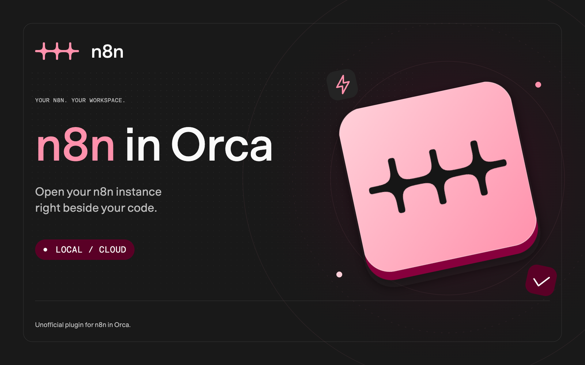
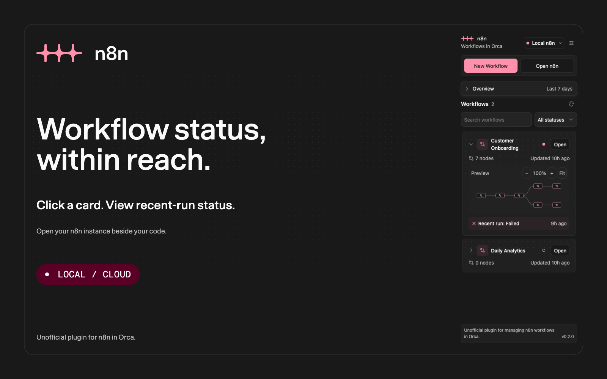
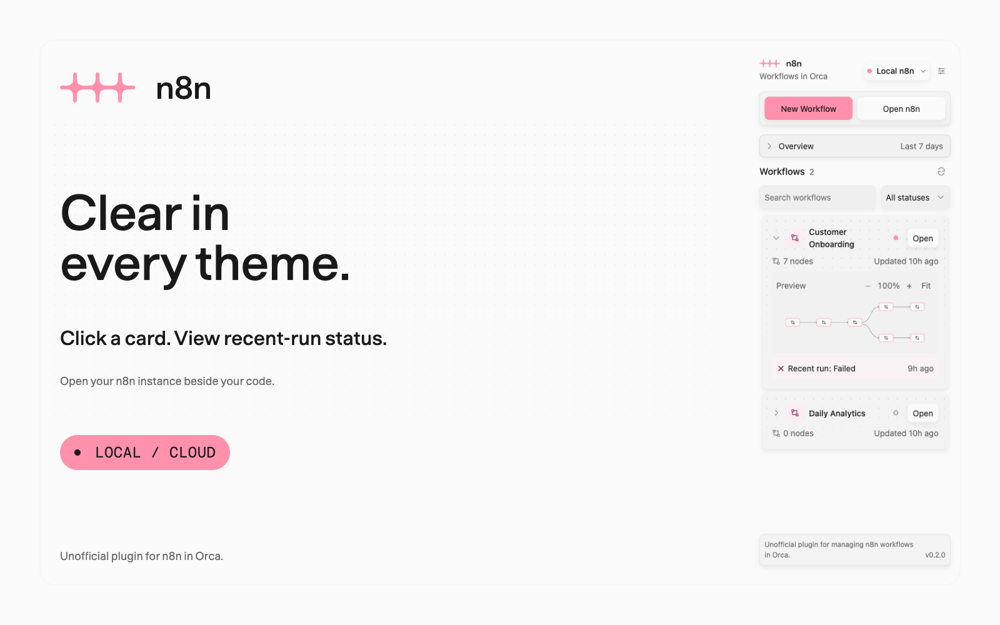
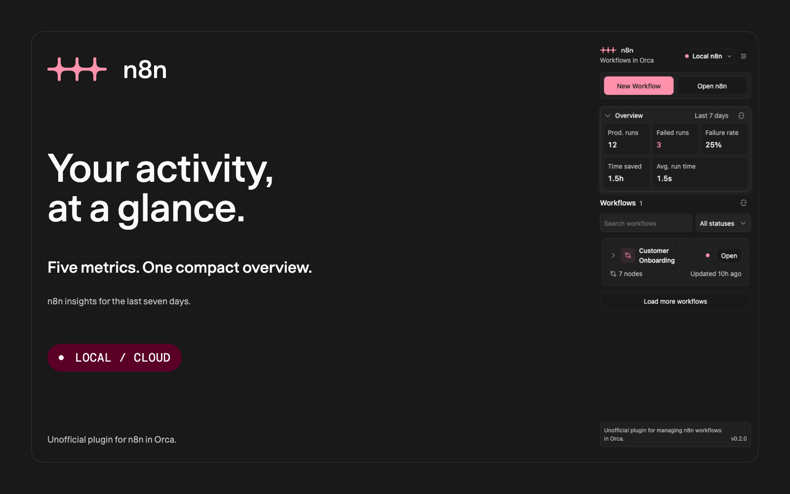
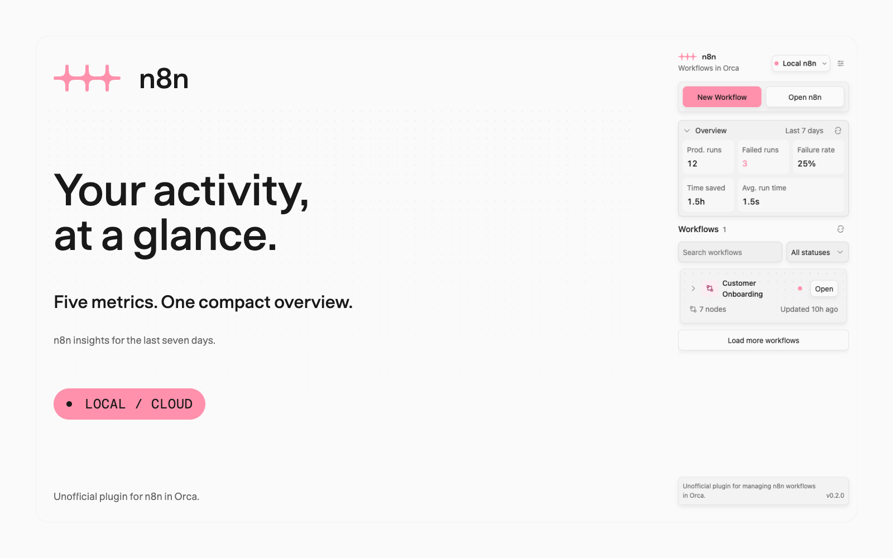

# n8n in Orca

**Your n8n. Right beside your code.**

Open your local or Cloud n8n instance inside [Orca](https://onorca.dev). Browse workflows and recent-run status in a compact sidebar, then open a workflow in n8n beside your code. Workflow editing and execution stay in your n8n instance.

[](https://onorca.dev) [](#preview) [](LICENSE)



Version **0.2.0**. The release process is documented in [RELEASE.md](RELEASE.md).

## Install

Requires **Orca desktop 1.4.248 or newer**, its compatible CLI, and a separately running local n8n or supported n8n Cloud instance.

Install a versioned release:

1. Open **Settings → Plugins**.
2. Choose **Add plugin → From a Git URL…** and enter:

   ```text
   https://github.com/faisalmuhammad/orca-n8n#v0.2.0
   ```

   Keep `#v0.2.0` at the end to install the release tag.
3. Review and approve the **trusted worker**, **plugin-owned storage and secrets**, and **workspace discovery and navigation** access.
4. Open **n8n** from the lightning icon in the sidebar and follow the setup guide.

All plugin runtime assets are included. Installation requires no Node.js, dependencies, or build step. n8n runs separately; the plugin does not start or manage it.

For local use before publication, add this folder through **Settings → Plugins → Development folders…**.

## Preview

| Dark | Light |
| --- | --- |
|  |  |

| Insights · Dark | Insights · Light |
| --- | --- |
|  |  |

The previews show the compiled sidebar with controlled sample workflows and an Orca bridge fixture. They contain no live workflow data or API keys. See [screenshot and artwork provenance](assets/SCREENSHOTS.md).

## Connect n8n

1. Choose **Local n8n** or **n8n Cloud** in connection settings and enter your instance address. The local default is `http://localhost:5678`; change it to the port your instance uses.
2. Choose placement: **Tab**, **Right split**, or **Below**. n8n opens automatically in the current Orca workspace.
3. Choose **Open n8n**, then sign in or finish account setup in n8n. Complete the sidebar setup guide when ready.
4. To load the workflow list, create a key in **n8n Settings → n8n API → Create an API key** and save it in **Connection settings**. Grant `workflow:list`, optionally `execution:list` for recent runs, and `insights:read` for the overview.

Opening n8n needs no API key. Sidebar discovery depends on your instance’s public API availability and permissions. n8n Cloud API access is unavailable during the free trial. One local or Cloud connection is saved at a time.

Local addresses must use loopback hosts such as `localhost` or `127.0.0.1`. Cloud addresses require HTTPS on an `n8n.cloud` subdomain. Remote self-hosted addresses and Cloud custom domains are outside this version. See [compatibility](COMPATIBILITY.md).

## Use

Choose **Open** on a workflow to view it in n8n. Orca resolves the current workspace for every action. Reopening the same workflow focuses its existing tab; a different workflow opens in a separate tab or split. No workspace selection is saved. Switching workspaces automatically changes where the next workflow opens.

Click a workflow card or its name to expand a read-only workflow preview and recent-run details. Use **− / +** to zoom, drag to pan while zoomed, and **Fit** to show the whole graph. The view stays in place during collapse, filtering, and refresh. **Enter** and **Space** toggle the focused workflow name. The **Open** button works independently.

Hover or focus the status dot beside **Open** to see Published, Draft, Archived, or Unavailable. **Escape** dismisses the tooltip.

Use **New Workflow** to open a fresh workflow editor without replacing another workflow tab. The same action is available as **New n8n workflow** in Orca’s command palette. The sidebar refreshes immediately after a successful launch when API access is configured; the new workflow appears after it is saved in n8n and the list refreshes.

The settings button controls the address, placement, API key, and automatic refresh. Setup can be revisited and exited without saving. **Delete connection** removes the saved connection and key after confirmation; the n8n instance and its workflows remain available.

## Features

| Feature | Behavior |
| --- | --- |
| Guided setup | Connect local n8n or n8n Cloud and choose a tab or split; the current workspace is automatic |
| Workflow discovery | Browse loaded workflows by most recent update, with names, publication state, and node counts |
| Search and filters | Search loaded pages and filter Published, Draft, or Archived workflows |
| Workflow preview | Expand a read-only graph when node structure is available; zoom up to 8× and pan |
| Status dots | Compact publication indicators with hover and keyboard-focus tooltips |
| Recent-run status | Expand a card to see available execution status and timing |
| Execution overview | Expand five compact metrics reported by n8n for the last seven days |
| Open and create | Open workflows or start a new one in your n8n instance |
| Automatic refresh | Refresh every 30 seconds by default; choose Off, 15/30 seconds, or 1/2/5 minutes |
| Manual refresh | Refresh from the Workflows heading; use Load more for additional pages |
| Theme support | Orca theme surfaces, n8n accents, keyboard navigation, and illustrated empty states |

Refresh pauses while the panel is hidden, settings are open, or an input has focus. Search and filtering apply to loaded pages, capped at 500 workflows. Recent-run status uses the latest 100 retained executions and may not represent every workflow’s last run. Execution permission failures do not hide workflows.

## Access and privacy

| Access | Purpose |
| --- | --- |
| Trusted Node worker | Check connections, fetch public API metadata, and open Orca browser tabs through its CLI |
| `storage:own` | Save connection settings, layout, and onboarding progress |
| `secrets:own` | Store API keys using Orca’s OS-keyring protection |
| `workspace:read` | Resolve the current local workspace automatically |
| `workspace:write` | Open and focus n8n tabs or splits in the current workspace |

The worker runs with your user account’s authority. API requests go through the worker; keys are bound to the configured instance and are never returned to the panel or stored in ordinary preferences. Saving a key requires secure storage. Browser sign-in stays in Orca’s browser session.

The panel receives workflow metadata, preview topology, and recent-run status, without node parameters, credentials, pinned data, or execution payloads. Metadata stays in memory and is cleared when changing connections. Authenticated redirects are refused, and requests have destination, size, and time limits.

The overview shows production executions, failed executions, failure rate, time saved, and average run time from the public insights API. It loads on expansion and refreshes with the list while open. Availability depends on the n8n version, plan, and insights:read permission; unavailable statistics never appear as zeros.

Detailed sidebar behavior, connection handling, and architecture are in the [usage guide](docs/usage.md).

<details>
<summary>Local development and validation</summary>

Requires **Node.js 22+**, npm, a compatible Orca desktop CLI, and Chromium for browser tests.

```sh
npm ci
orca plugin types . --json
npx playwright install chromium
npm run check
```

Set `ORCA_CLI_COMMAND` to the compatible Orca executable when it is not on your PATH. Set `N8N_BROWSER_EXECUTABLE` to reuse an existing Chromium installation.

```sh
orca plugin dev load . --json
orca plugin open local.n8n --panel n8n --json
```

The build bundles TypeScript into `panel/` and `worker/` and prepares an installable folder at `dist/plugin/`. Building publishes nothing.

Worker and browser checks cover connections, public API metadata, secure key storage, browser reuse, onboarding, keyboard navigation, card expansion, refresh, deletion, and light/dark layouts. Local n8n 2.47.3 has been exercised; Cloud behavior uses fixtures. See [compatibility](COMPATIBILITY.md) for supported connections and testing limits.

Listing artwork is committed in `assets/`. `npm run release:check` verifies publication files, image budgets, version metadata, and sensitive local text. Proprietary brand fonts are not distributed.

To prepare a new release, change the manifest version and add its changelog entry, then run `npm run release:prepare` and `npm run check`. Commit and push or merge to main; GitHub Actions creates the matching tag and release after validation. Existing releases are preserved.

The GitHub social preview is included at [assets/social.png](assets/social.png). See [RELEASE.md](RELEASE.md) and [CHANGELOG.md](CHANGELOG.md) for publication and version details.

</details>

## Attribution and license

An unofficial community plugin maintained by [faisalmuhammad](https://github.com/faisalmuhammad). Plugin code and original artwork use [MIT](LICENSE).

n8n and its official logo assets remain the property of n8n GmbH. The plugin uses unmodified assets from the [n8n brand guidelines](https://guidelines.n8n.design/); n8n software and proprietary fonts are not redistributed. See [third-party notices](THIRD_PARTY_NOTICES.md).
